# ARCHITECTURE -- FerrumTorrens

This is the living description of how the engine is put together: the
high-level building blocks, the build process, and a static plus a dynamic view
of each subsystem. It exists so a reader can see the current shape of the code
without reconstructing it from `TODO.md`.

The three documents divide the work:

- `TODO.md` -- the plan and the current status. **Plan of record.**
- `ALGORITHM.md` -- the exact math and caching algorithms (forward pass, MoE
  offload, KV/radix, GDN state). **Algorithm of record.**
- `ARCHITECTURE.md` (this file) -- the code as built, and the boundaries between
  its parts. **Description of record.**

## Status legend

Every subsystem and module below carries one of:

- `[core]` -- implemented, wired, and exercised by tests.
- `[partial]` -- implemented but not fully wired, or wired for a bounded case.
- `[TODO]` -- planned, not implemented. Described only as a boundary, never in
  full: the design of unbuilt work belongs in its `TODO.md` slice.

The doc is deliberately **lean**. It describes what exists and names the next
planned boundary, and marks the rest `[TODO]`. It does not pre-architect the
future, because a design written before its slice is a guess that goes stale.

## Architectural rules

- Clean architecture / hexagonal / DDD. Three rings, dependencies point inward:
  `domain` (pure, no CUDA, no IO) <- `application` (use-cases) and
  `infrastructure`/`models` (adapters). The domain never imports an adapter.
- The engine is **model-agnostic**. Only `src/models/<arch>/` and the registry
  entry in `application/registry.rs` are arch-specific. MoE offload caching,
  prefill/decode streaming and KV/radix are core engine obligations shared by
  every supported model.
- Ports are Rust traits in `domain`; adapters implement them. Infra types
  (device tensors, mmap handles, HTTP types) never cross into the domain.
- Runtime is Rust only. Python is a **build-time** toolchain (kernel authoring +
  AOT, and the one-time HF -> FTW conversion).

---

## 1. High-level building blocks

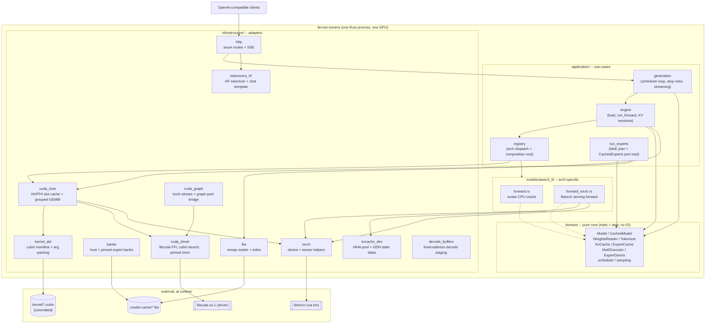

Reading the graph: requests enter through `http`, the `generation` loop drives
the `engine`, which dispatches once through the `registry` to an arch `Model`.
The model runs its forward via `torch` (serving) or the scalar oracle. The MoE
block is not part of the model: the model hands its routing decision to the
core `MoEExecutor` port, implemented by `run_experts::CachedExperts` over the
`cuda_moe` adapter and the committed cubins. Everything the domain sees is a
trait.

---

## 2. Build process

Two builds, plus an offline kernel step.

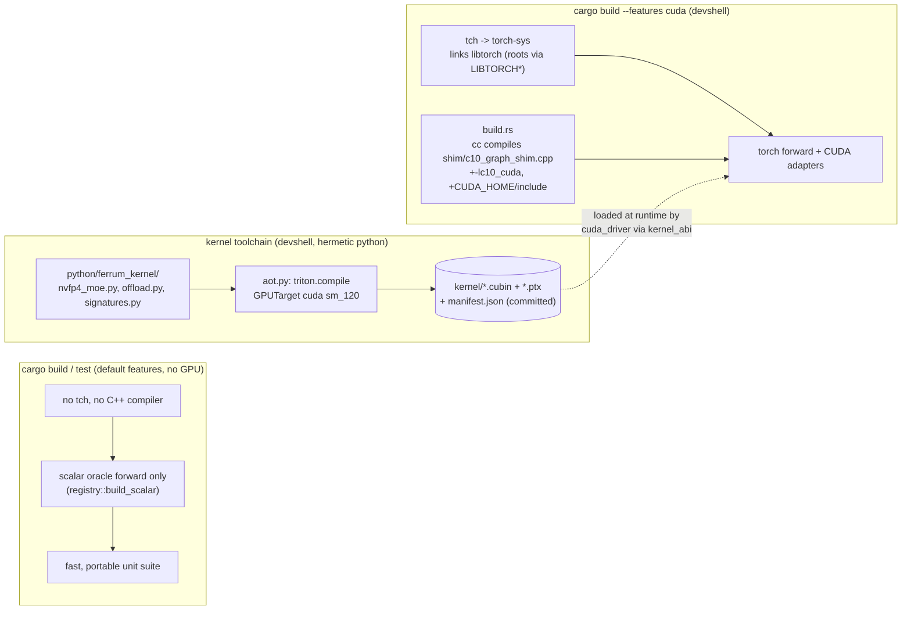

- **`cuda` is a cargo feature, not a build-time fact.** `tch` is optional, so
  the default CPU build needs no libtorch and no C++ compiler. With the feature
  off, the registry hands back the scalar oracle; with it on, the libtorch
  forward. `cargo fmt` + `cargo clippy` + `cargo test` stay green without the
  feature and must be re-run with it in the devshell.
- **`build.rs` only compiles the capture bridge.** Under `--features cuda` it
  invokes `cc` on `shim/c10_graph_shim.cpp` (the torch CUDA current-stream and
  graph-mempool facilities `tch` does not expose), and adds
  `-L$LIBTORCH_LIB/lib -lc10_cuda`. Without the feature it is a no-op.
- **Kernels are authored in Triton, compiled ahead of time, and committed.**
  `python/ferrum_kernel/aot.py` emits `kernel/*.cubin`, `*.ptx` and
  `manifest.json`. The engine never runs an interpreter; `kernel_abi.rs` parses
  the manifest and `cuda_driver.rs` launches the cubins. The devshell aliases
  `kernel-aot`, `kernel-selftest` (CPU interpreter gate) and
  `kernel-compile-check` are the kernel inner loop.
- **The devshell exports the roots** `LIBTORCH`, `LIBTORCH_INCLUDE`,
  `LIBTORCH_LIB`, `CXX`, `CUDA_HOME` and the loader path, and wires Triton's
  `ptxas` and `libcuda` probes. `scripts/run-gated.sh` (`ft-gate`) runs the
  heavy real-checkpoint tests serially under an `RLIMIT_AS` cap.

---

## 3. Subsystems

### 3.1 Config and startup `[core]`

**Static.** `config.rs` parses the TOML into typed structs (`Serve`, `Model`,
`Moe`, `Kv`, `Sampling`, `Kernel`, `Config`) with `deny_unknown_fields`, and
validates. It holds no model fields: `model.path` is an FTW directory.

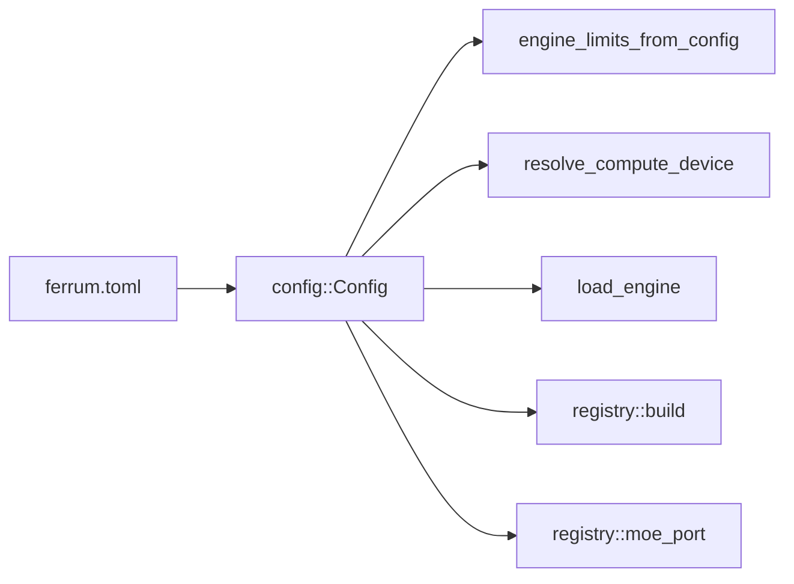

**Dynamic -- startup.**

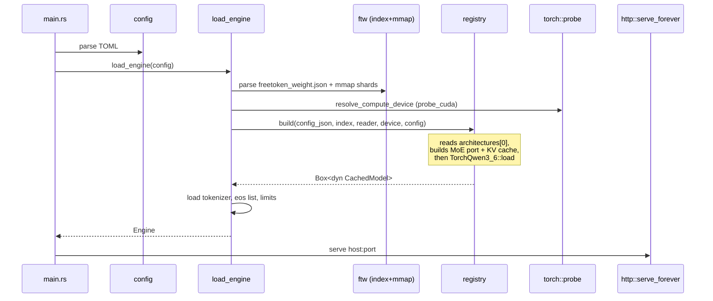

### 3.2 Domain core -- the ports `[core]`

All boundaries are traits; adapters implement them. This is the static view of
the whole port surface.

```mermaid
classDiagram
  class Model { <<trait>> +params() +forward(ForwardInput) +probe_layers() }
  class CachedModel { <<trait>> +cache() +expert_steps() +forward_cached(input, cache) }
  CachedModel --|> Model

  class WeightsReader { <<trait>> +read_range(off, n, dst) }
  class Tokenizer { <<trait>> +encode() +decode() +render_chat() }
  class KvCache { <<trait>> +begin() +reserve() +end() +available() }
  class MoEExecutor { <<trait>> +execute_device(req, out) +steps() }
  class ExpertGemm { <<trait>> +grouped_moe() +grouped_moe_dev() +grouped_moe_staged() }
  class ExpertSlotStore { <<trait>> +load(layer, expert, slot) +slots() }
  class ExpertSlabSource { <<trait>> +slab(layer, expert, part) }
  class PinnedBankSource { <<trait>> +banks() }
  class MoETensor { <<trait>> +numel() +to_host_f32() +as_any() }

  class Qwen3_6
  class TorchQwen3_6
  class HfTokenizer
  class MmapFtwReader
  class DeviceCache
  class FtwBanks
  class FtwPinnedBanks
  class CudaMoE
  class CachedExperts
  class DevTensor

  Qwen3_6 ..|> CachedModel
  TorchQwen3_6 ..|> CachedModel
  HfTokenizer ..|> Tokenizer
  MmapFtwReader ..|> WeightsReader
  DeviceCache ..|> KvCache
  FtwBanks ..|> ExpertSlabSource
  FtwPinnedBanks ..|> PinnedBankSource
  CudaMoE ..|> ExpertGemm
  CudaMoE ..|> ExpertSlotStore
  CachedExperts ..|> MoEExecutor
  DevTensor ..|> MoETensor
```

Note the two deliberate non-obvious shapes:

- `CudaMoE` implements both `ExpertGemm` and `ExpertSlotStore`; one
  `Mutex<CudaMoE>` handle is passed as both so the plan and the kernels see the
  same device banks.
- `MoETensor` is opaque on purpose: the domain counts elements and reads only
  the routes; the adapter downcasts via `as_any`. It is not `mockall`-mocked
  (its `Box<dyn Any>` expectation is not `Sync`); tests use host-backed doubles.

### 3.3 Weights and the FTW reader `[core]`

**Static.** The FTW directory holds `freetoken_weight.json` (index), 4096-aligned
`freetoken-NNNNN.ftw` shards, and the copied HF `config.json`/`tokenizer.json`.

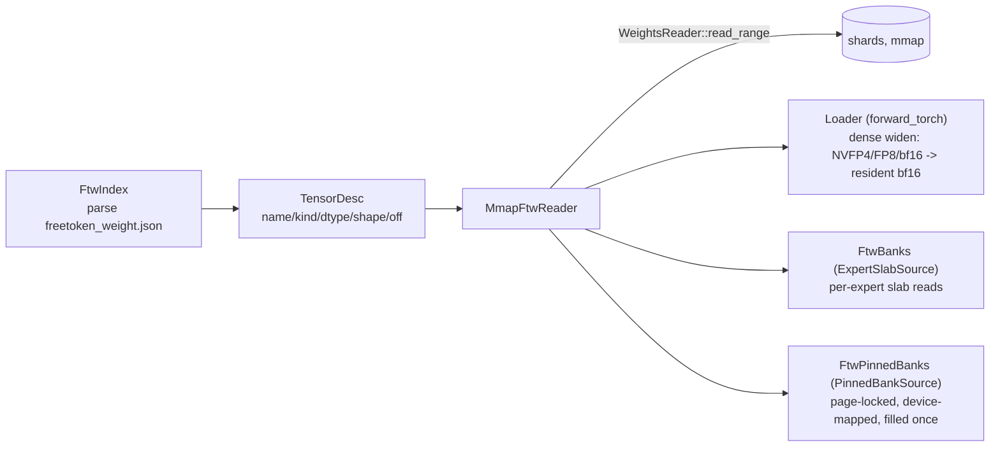

Key conventions: the FTW holds **post-loader** weights, so Gemma `1+w` norms are
already folded and must not be folded again; NVFP4 per-row globals are f16 while
FP8 scales are f32.

**Dynamic -- dense load and resident widening.**

```mermaid
sequenceDiagram
  participant Reg as registry::build
  participant Ld as TorchQwen3_6::load
  participant Rd as MmapFtwReader
  participant Dev as device
  participant MoE as registry::moe_port
  Reg->>Ld: load(params, device, index, reader, moe, cache)
  loop each dense projection / embedding / lm_head
    Ld->>Rd: read_range (4096-row window)
    Ld->>Ld: dequant to f32, cast to bf16
    Ld->>Dev: copy window into resident tensor
  end
  Note over Ld: ~4.5 GiB resident bf16;<br/>apply/gather never re-read
  Reg->>MoE: if kernel.triton: CudaMoE + FtwPinnedBanks
```

### 3.4 Model tower `[core]`

**Static.** `models/qwen3_6/` owns the arch: `config.rs` (text_config ->
`ModelParams`), `weights.rs` (tensor names), `forward.rs` (scalar oracle) and
`forward_torch.rs` (serving). Both implement `CachedModel`, so the engine cannot
tell which is loaded (decision 12/21).

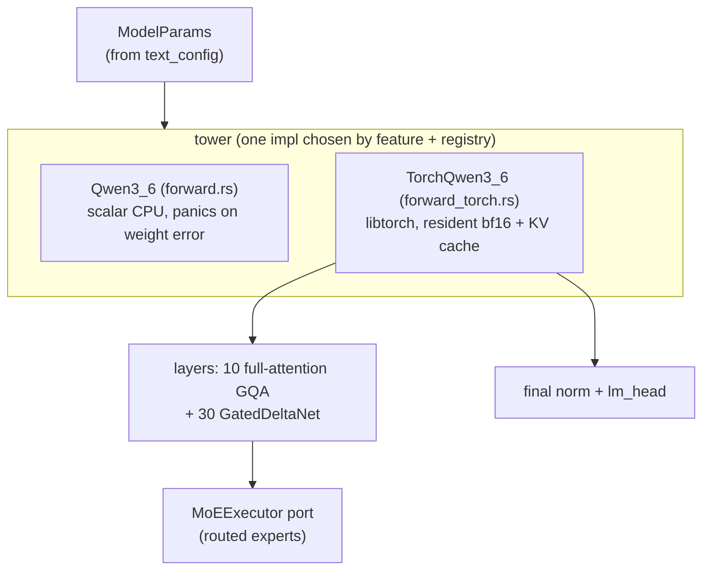

**Dynamic -- one cached decode step** (per request, single-sequence; batch is a
kernel question, not a scheduling one).

```mermaid
sequenceDiagram
  participant Eng as Engine::run_forward_cached
  participant M as TorchQwen3_6::forward_cached
  participant KV as DeviceCache / MhaPool
  participant ST as LinearStateSlabs
  participant P as MoEExecutor (CachedExperts)
  participant K as cuda_moe + cubins
  Eng->>KV: reserve(n) pages for the new tokens
  Eng->>M: forward_cached(input, cache)
  M->>M: embed -> per layer
  loop full-attention layers
    M->>KV: store K/V at tail, gather filled
    M->>M: partial rope + attention_cached (causal mask at q_offset)
  end
  loop GDN layers
    M->>ST: read conv + recurrent state at slot
    M->>M: conv1d + delta-rule recurrence
    M->>ST: write back conv + recurrent state
  end
  M->>P: execute_device(activations, ids, weights)
  P->>K: lru_ensure + index_copy + grouped GEMM
  K-->>M: routed sum (device)
  M->>M: shared expert + add; final norm
  M->>M: lm_head block pass -> out buffer (device, no host round-trip)
  M-->>Eng: forward_cached reads out back; forward_cached_into leaves it device-local
```

Both addressing modes run the same tower. `forward_cached` reads ids, positions
and the KV window from the host `SequenceCache` (`CacheAccess::Host`) and copies
the logits back; `forward_decode_into(bufs)` reads them from the device
`DecodeBuffers` (`CacheAccess::Device`) and leaves the logits device-local. The
device path gathers attention over a **fixed-length window** (`DecodeBuffers::
window`, staged per row by `stage_window`): the lagging slots are dropped by the
step-position mask and carry only a valid pool index, so the gather keeps the
same shape and addresses every step -- the precondition for a captured graph.

### 3.5 MoE offload `[core]` (prefill overlap `[TODO]`)

The heart of the port. The engine's MoE obligation is split: the model computes
the router and top-k ids; `run_experts` owns
`ensure -> stream misses -> grouped GEMM -> weighted sum`.

**Static.**

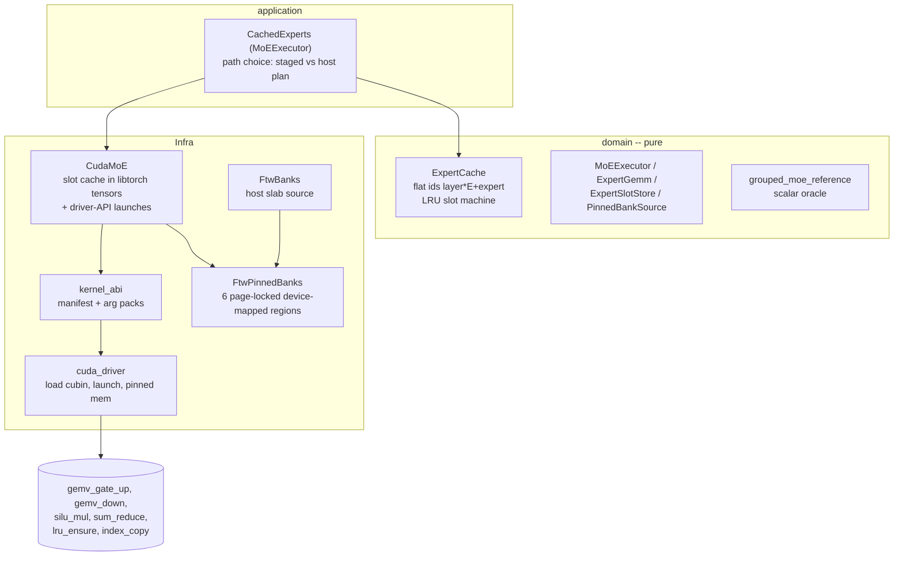

**Dynamic -- device-staged layer step** (`grouped_moe_staged`). This is the path
a captured graph needs: the residency plan never crosses to the host.

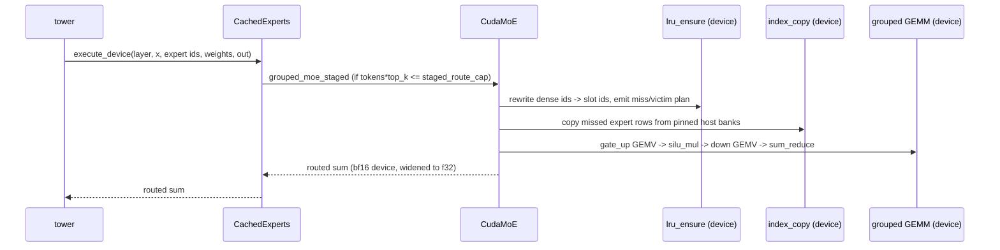

If a step is past the cubin's baked route cap (large prefill), `CachedExperts`
falls back to the host plan (`run_experts` + `ExpertCache` + `FtwBanks`), and the
two residency states are reset on every path transition.

`[TODO]` Prefill double-buffered whole-layer streaming and the
`prefill_overlap` two-buffer path (`cache_size_slots >= 2*num_experts`) are not
implemented; prefill currently takes the host plan.

### 3.6 KV cache, radix, and GDN state `[core]` (radix wired into serving `[partial]`)

**Static.** The domain owns the bookkeeping (pages, page table, radix tree,
state-slot pool, `SequenceCache`); the adapter owns the device slabs.

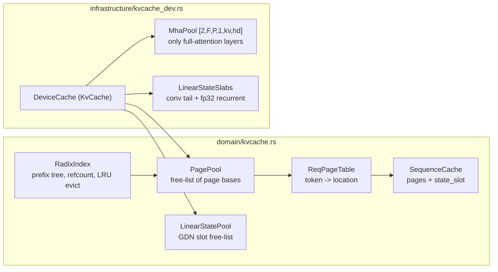

**Dynamic -- prefill growth and decode step.** Pages are handed out by the
engine, the model stores K/V at those locations, and the next step reads them
back instead of re-feeding the prefix.

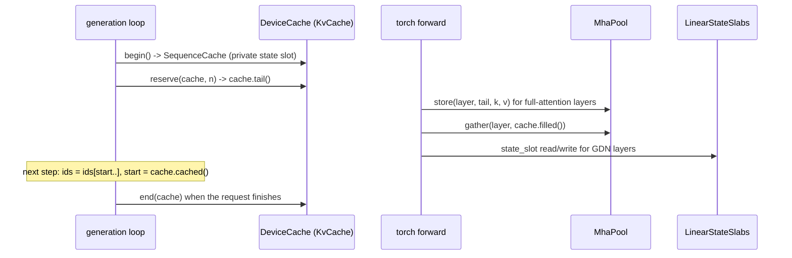

`[TODO]`/`[partial]`: the radix tree is implemented and unit-tested in the
domain, and the engine decodes off per-request page tables, but the server does
not yet commit finished prefixes into the radix tree for cross-request reuse;
`hybrid_radix` GDN-state donation is `[TODO]` (MVP keeps cold per-request GDN
states). f32 KV is the correctness dtype; fp8/bf16 `kv_cache_dtype` is `[TODO]`
and is the lever when VRAM binds.

### 3.7 Scheduler and sampling `[core]`

**Static.** Pure logic in `domain/scheduler.rs` and `domain/sampling.rs`.

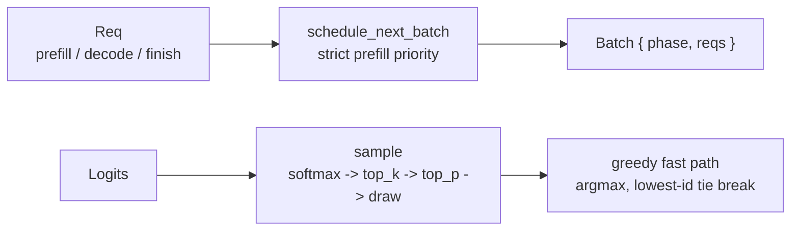

**Dynamic.** Strict prefill-priority: a step is either prefill or decode, never
both. Decode rows are sorted by `uid` for determinism. Stop priority is
EOS/stop-string over max-tokens.

### 3.8 HTTP serving and generation `[core]`

**Static.** `infrastructure/http.rs` (axum) exposes `/v1/completions`,
`/v1/chat/completions`, `/v1/models`, `/health`; `application/generation.rs`
owns the loop; `tokenizers_hf.rs` encodes/decodes and renders the chat template.

**Dynamic -- a streaming request.**

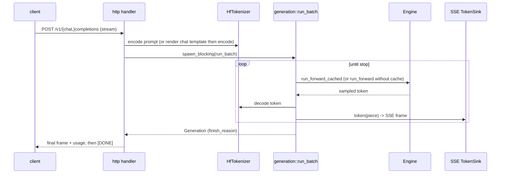

The whole forward runs inside `tokio::task::spawn_blocking`, so the async
runtime is never blocked by GPU work. A client hang-up aborts the run.

### 3.9 CUDA-graph decode capture `[partial]`

The goal is one captured executable per decode batch size, over the whole
forward, with the MoE launches inside it (decision 40). The addressing and
fixed-window preconditions are now in place; the capture itself is next.

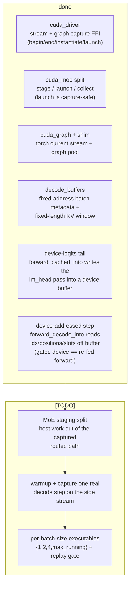

**Dynamic -- capture and replay (target shape).**

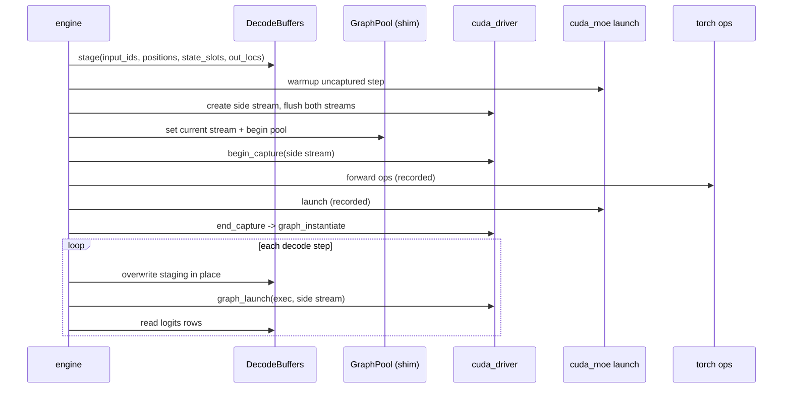

Contracts already fixed: capture runs only on a flags-0 side stream (never the
legacy stream); a `StagedGroup` and the pinned banks must outlive every graph
captured over them; a captured grid pins the batch shape; `stage_into` is the
only writer between replays. The whole step is now capture-shaped. The forward's
tail is device-local: `TorchQwen3_6::forward_cached_into` writes the `lm_head`
block pass straight into a caller-owned device logits buffer with no host
round-trip, and `forward_decode_into` addresses the same forward entirely from a
`DecodeBuffers` row (ids, positions, state slots, fixed KV window). The
device-staged MoE port (`routed_via_port` -> `grouped_moe_staged`) reads its
activations, router ids and route weights off device buffers, keeps its `E2M1`
decode table resident, and builds the rope table on the device, so no step
uploads a host tensor. `tests/decode_graph_capture.rs` captures one whole real
decode step and replays it equal to the uncaptured twin; the per-batch-size
executables are the next piece.

---

## 4. External libraries and where they are used

| Library / tool | Kind | Used by | Purpose |
|---|---|---|---|
| `libtorch` (via `tch`) | runtime, `cuda` feature | `infrastructure/torch.rs`, `models/qwen3_6/forward_torch.rs`, `infrastructure/kvcache_dev.rs`, `infrastructure/cuda_moe.rs` | All dense compute (GEMMs, norms, rope, attention, GDN), device tensors, the KV/state slabs, and the MoE slot banks |
| CUDA driver API (`libcuda.so.1`) | runtime, hand-rolled FFI | `infrastructure/cuda_driver.rs` | Load and launch the committed cubins, allocate device + page-locked memory, capture and replay CUDA graphs |
| Triton (cubins) | build-time authoring; committed artifacts at runtime | `python/ferrum_kernel/*`, `kernel/*.cubin` | The one hand-written NVFP4 grouped-MoE GEMV plus the silu/sum-reduce and the two offload staging kernels. Authored and AOT-compiled in Python; launched by `cuda_driver` with no interpreter at runtime |
| `c10_cuda` (torch C++) | runtime, via `build.rs` shim | `shim/c10_graph_shim.cpp`, `infrastructure/cuda_graph.rs` | The torch current-stream set and the graph memory pool that `tch` does not expose; needed for CUDA-graph capture of torch ops |
| `axum` + `tokio` | runtime | `infrastructure/http.rs`, `main.rs` | HTTP server, SSE streaming, and the async runtime that offloads forwards to blocking threads |
| `tokenizers` + `minijinja` | runtime | `infrastructure/tokenizers_hf.rs` | HF byte-level BPE tokenizer and the checkpoint's chat template (Python string methods rewritten to filters) |
| `memmap2` | runtime | `infrastructure/ftw.rs` | mmap the FTW shards for zero-copy weight access |
| Python + `uv` (FreeToken venv) | build-time only | `scripts/convert_hf_to_ftw.py`, `FreeToken/` | The one-time HF -> FTW conversion via `ft checkpoint`; never in the serving process |

Boundary note: `tch`/`Tensor` and the CUDA driver handles live entirely in
`infrastructure`; the domain sees only `MoETensor`, counts and opaque bytes.

---

## 5. Cross-cutting invariants

- **One allocator, one CUDA context.** The slot banks are libtorch tensors and
  the driver launches read their raw pointers, so there is a single context and
  a single allocator behind both paths.
- **Stable addresses for capture.** Dense weights, MoE banks and pinned host
  banks are allocated once and never move; that is a precondition for a captured
  graph to bake their pointers.
- **Least-lock, `&self` ports.** The device slot cache is process-wide, so the
  store/gemm ports take `&self` and `Mutex<CudaMoE>` is passed as both.
- **The scalar forward is an oracle.** It stays behind the same `Model` trait,
  is what runs in the CPU build, and is what the libtorch path is checked
  against (plus the pinned FreeToken token oracle).
- **Gated tests.** GPU-only work is `--ignored` and run under
  `scripts/run-gated.sh` (serial, address-space capped); CPU-only units run in
  plain `cargo test`.
