# ARCHITECTURE -- FerrumTorrens

This is the living description of how the engine is put together: the
high-level building blocks, the build process, and a static plus a dynamic view
of each subsystem. It exists so a reader can see the current shape of the code
without reconstructing it from `TODO.md`.

The documents divide the work:

- `README.md` -- the entry point: what the project is, the target, how to build.
- `TODO.md` -- the open plan and the current status. **Plan of record.**
- `DONE.md` -- history and the full decision log; look up `decision N` here.
- `ALGORITHM.md` -- the exact math and caching algorithms (forward pass, MoE
  offload, KV/radix, GDN state). **Algorithm of record.**
- `ARCHITECTURE.md` (this file) -- the code as built, and the boundaries between
  its parts. **Description of record.**

## Status legend

Every subsystem and module below carries one of:

- `[core]` -- implemented, wired, and exercised by tests.
- `[partial]` -- implemented but not fully wired, or wired for a bounded case.
- `[TODO]` -- planned, not implemented. Described only as a boundary, never in
  full: the design of unbuilt work belongs in its `TODO.md` slice.

The doc is deliberately **lean**. It describes what exists and names the next
planned boundary, and marks the rest `[TODO]`. It does not pre-architect the
future, because a design written before its slice is a guess that goes stale.

## Architectural rules

- Clean architecture / hexagonal / DDD. Three rings, dependencies point inward:
  `domain` (pure, no CUDA, no IO) <- `application` (use-cases) and
  `infrastructure`/`models` (adapters). The domain never imports an adapter.
- The engine is **model-agnostic**. Only `src/models/<arch>/` and the registry
  entry in `application/registry.rs` are arch-specific. MoE offload caching,
  prefill/decode streaming and KV/radix are core engine obligations shared by
  every supported model.
- Ports are Rust traits in `domain`; adapters implement them. Infra types
  (device tensors, mmap handles, HTTP types) never cross into the domain.
- Runtime is Rust only. Python is a **build-time** toolchain (kernel authoring +
  AOT, and the one-time HF -> FTW conversion).

---

## 1. High-level building blocks

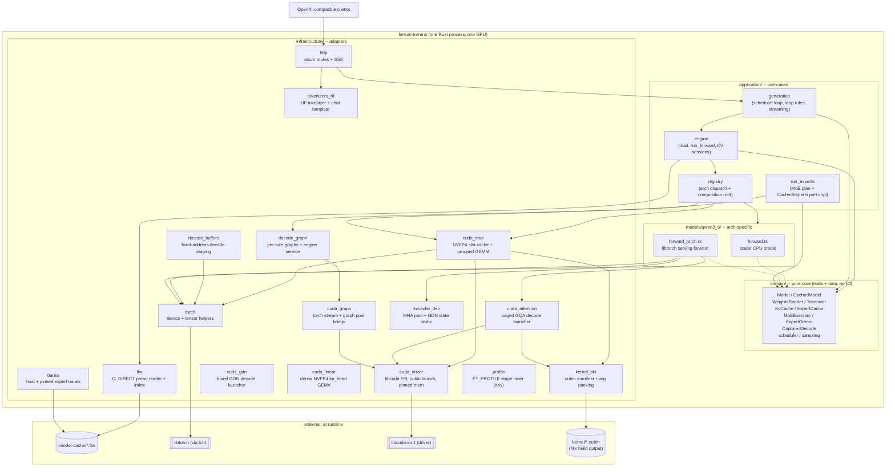

Reading the graph: requests enter through `http`, the `generation` loop drives
the `engine`, which dispatches once through the `registry` to an arch `Model`.
The model runs its forward via `torch` (serving) or the scalar oracle. The MoE
block is not part of the model: the model hands its routing decision to the
core `MoEExecutor` port, implemented by `run_experts::CachedExperts` over the
  `cuda_moe` adapter and the cubins. Everything the domain sees is a
  trait.

### 1.1 Host/device split (one process, one GPU)

The serving build (`cuda` feature, `model.device = "cuda"`) keeps the heavy,
stateful work on the device and the control plane on the host. The domain core
stays pure: `Tensor` and CUDA handles never cross it (section 4).

| Block | Runs on | Where |
|---|---|---|
| HTTP + SSE, batching dispatcher, scheduling, stop rules, streaming | Host | `infrastructure/http.rs`, `application/dispatcher.rs`, `domain/scheduler.rs`, `application/generation.rs` |
| Tokenize / detokenize, chat template + tools, tool-call parse | Host | `infrastructure/tokenizers_hf.rs`, `infrastructure/tool_call.rs`, via `Engine::encode/decode` |
| Sampling (temperature/top-k/top-p/penalties) | Host | `domain/sampling.rs`, over f32 logits copied D2H |
| Generation loop + KV page-table bookkeeping (`SequenceCache`) | Host | `domain/kvcache.rs`, `application/engine.rs` |
| FTW index parse + O_DIRECT pread of the checkpoint | Host | `infrastructure/ftw.rs` |
| Pinned expert banks (17.3 GiB, page-locked, device-mapped) | Host memory | `infrastructure/banks.rs` (`FtwPinnedBanks`) |
| Dense weights: embedding + all projections + `lm_head` (4.51 GiB bf16; the lm_head kept packed NVFP4 on CUDA) | Device | `models/qwen3_6/forward_torch.rs` |
| Embedding gather, RMSNorm, RoPE, attention (GQA), GDN recurrence, `lm_head` | Device | `models/qwen3_6/forward_torch.rs` (libtorch) + `infrastructure/cuda_linear.rs` (dense NVFP4 head) |
| Router: gate matmul + softmax + top-8 | Device | `forward_torch.rs::moe` (ids stay device) |
| Routed experts: slot cache + grouped GEMV | Device | `infrastructure/cuda_moe.rs` (cudarc storage + driver-API cubins) |
| Slot residency plan (`lru_ensure` / whole-layer) | Device (host plan fallback) | `python/ferrum_kernel/offload.py`, `application/run_experts.rs` |
| KV pool, GDN state slabs, paged GQA attention | Device | `infrastructure/kvcache_dev.rs`, `infrastructure/cuda_attention.rs` |
| CUDA-graph capture/replay, torch graph pool | Device | `infrastructure/decode_graph.rs`, `infrastructure/cuda_graph.rs`, `infrastructure/cuda_driver.rs` |
| Decode stage profile (dev only, `FT_PROFILE=1`) | Device timing events | `infrastructure/profile.rs`; reference probe in `scripts/freetoken_probe/` |

Crossings per step: token ids H2D, streamed expert rows H2D (misses only), logits
D2H (for host sampling). The pinned expert banks and the dense weights are set up
once at load. A build without the `cuda` feature, or with `model.device = "cpu"`,
takes the scalar oracle instead and runs every stage on the host
(`models/qwen3_6/forward.rs`, decision 12).

**Profiling (dev only).** `FT_PROFILE=1` opens timing events on the forward's
torch stream and labels stages in `forward_torch.rs` (`embed`, `norm_in`,
`attn`/`gdn`, `norm_post`, `head`, `router`, `shared`) and `cuda_moe.rs`
(`moe_lru`, `moe_copy`, `moe_gemm`), dumping `/tmp/ft_profile.{txt,json}` after N
decode steps. It needs `cuda_graph = false` (a captured graph has no Python-side
stage boundary); `single_request_throughput_smoke` with `FERRUM_SMOKE_NOGRAPH=1`
drives it. `scripts/freetoken_probe/` times the read-only reference the same way
by monkeypatch (decision 88), which is how the per-stage comparison was made.

---

## 2. Build process

Two builds, plus an offline kernel step.

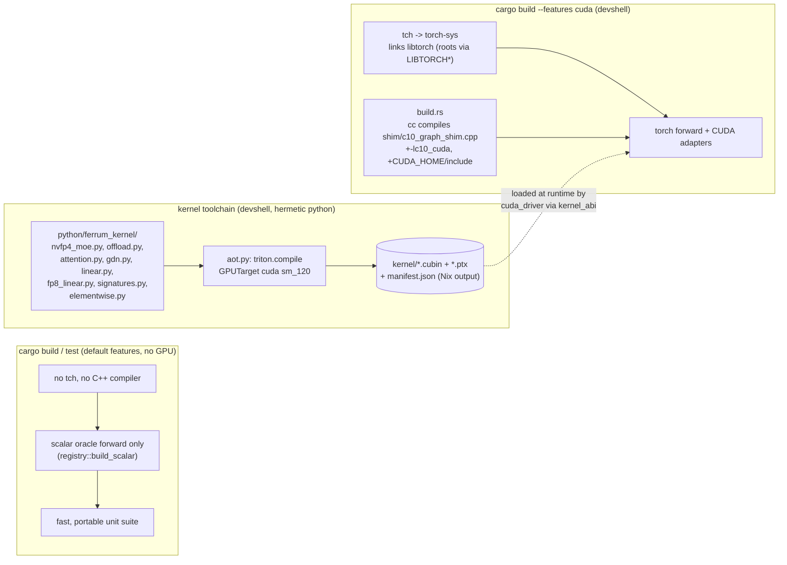

- **`cuda` is a cargo feature, not a build-time fact.** `tch` is optional, so
  the default CPU build needs no libtorch and no C++ compiler. With the feature
  off, the registry hands back the scalar oracle; with it on, the libtorch
  forward. `cargo fmt` + `cargo clippy` + `cargo test` stay green without the
  feature and must be re-run with it in the devshell.
- **`cudarc` is a separate non-default feature.** It builds the M7.1 adapter
  without `tch`, so it can be compiled and tested without libtorch. The NVFP4
  MoE adapter (`cuda_moe.rs`) is on this storage too under `feature = "cudarc"`;
  its gate is the real-hardware `tests/cuda_moe_matches_reference.rs`. The
  devshell points `CUDA_HOME` at a merged root whose `libcublas` is CUDA 13.4
  (the 12.9 copy is the M7.0 prefill slowdown) and sets
  `CUDARC_CUDA_VERSION=13040`; Triton keeps the 12.9 `ptxas`.
- **`build.rs` stages the cubins and compiles the capture bridge.** Every build
  copies `$FERRUM_KERNEL_DIR/kernel` (the `kernels` Nix derivation,
  `nix/kernels.nix`) into `OUT_DIR/kernel`; under `--features cuda` it also
  invokes `cc` on `shim/c10_graph_shim.cpp` (the torch CUDA current-stream and
  graph-mempool facilities `tch` does not expose) and adds
  `-L$LIBTORCH_LIB/lib -lc10_cuda`.
- **Kernels are authored in Triton and compiled ahead of time by Nix.**
  `python/ferrum_kernel/aot.py` emits `kernel/*.cubin`, `*.ptx` and
  `manifest.json` in the `kernels` derivation; nothing is committed. The engine
  never runs an interpreter; `kernel_abi.rs` parses the manifest and
  `cuda_driver.rs` launches the cubins. The manifest has four
  launch contracts, one section each: `kernels` (the six grouped-MoE passes:
  `gemv_gate_up`/`gemv_down` for decode, `grouped_gate_up`/`grouped_down`, the
  batched prefill grouped GEMM (R10.2, decision 112), `silu_mul` and
  `sum_reduce`),
  `staging` (`lru_ensure`, `index_copy`), `attention` (`paged_attention` f32 and
  `paged_attention_bf16`, the pool-dtype variants) and
  `linear` (`gdn_decode`, the fused GDN decode, `conv_decode`, the fused GDN
  causal conv + silu, `gdn_tri_solve`, the prefill chunk triangular solve,
  `nvfp4_dense_gemv`, the lm_head tail,
  `fp8_gemv`/`fp8_splitk_reduce`/`fp8_gemm`, the vendored W8A16 FP8 projections,
  and the M7.1 elementwise set: `add`/`mul` in bf16 and f32, bf16<->f32 cast,
  bf16 row `index_select`, and the strided copy `contiguous()` uses).
  The devshell aliases
  `kernel-aot`, `kernel-selftest` (CPU interpreter gate) and
  `kernel-compile-check` are the kernel inner loop.
- **The devshell exports the roots** `LIBTORCH`, `LIBTORCH_INCLUDE`,
  `LIBTORCH_LIB`, `CXX`, `CUDA_HOME` (the merged 12.9 toolkit + 13.4 cuBLAS
  root cudarc links), `CUDARC_CUDA_VERSION` and the loader path, and wires
  Triton's `ptxas` (still 12.9) and `libcuda` probes. `scripts/run-gated.sh` (`ft-gate`) runs the
  heavy real-checkpoint tests serially under an `RLIMIT_AS` cap.
- **The Nix side is three files.** `flake.nix` owns the project (the toolchain
  packages and the devshell), `nix/kernels.nix` builds the cubins, and
  `nix/agents.nix` owns the jailed opencode: agent-toolbox bakes the agent
  config into the package, `envFromFile` reads the opencode-go credential on
  the host, and the permissions grant the GPU, the store and the daemon
  socket. The devshell provides the agent package (`agents.opencode`).

---

## 3. Subsystems

### 3.1 Config and startup `[core]`

**Static.** `config.rs` parses the TOML into typed structs (`Serve`, `Model`,
`Moe`, `Kv`, `Sampling`, `Kernel`, `Config`) with `deny_unknown_fields`, and
validates. It holds no model fields: `model.path` is an FTW directory.

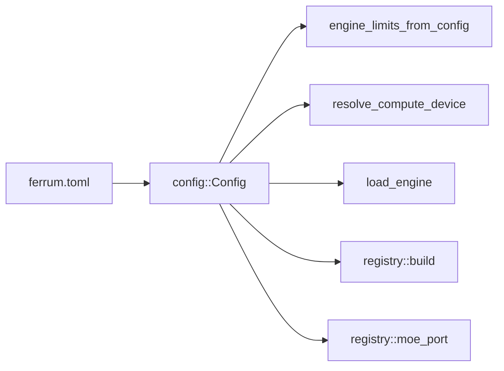

**Dynamic -- startup.**

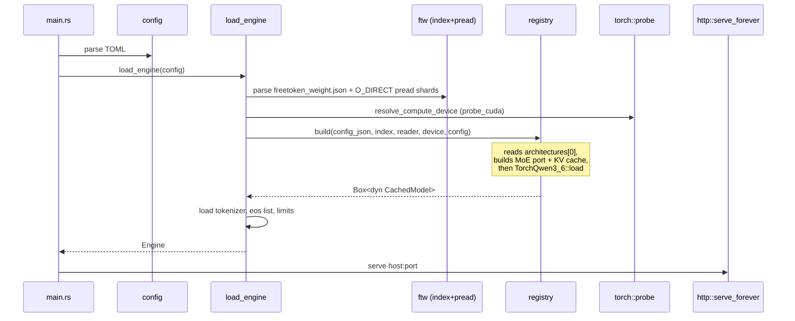

### 3.2 Domain core -- the ports `[core]`

All boundaries are traits; adapters implement them. This is the static view of
the whole port surface.

```mermaid
classDiagram
  class Model { <<trait>> +params() +forward(ForwardInput) +probe_layers() }
  class CachedModel { <<trait>> +cache() +expert_steps() +forward_cached(input, cache) }
  CachedModel --|> Model

  class WeightsReader { <<trait>> +read_range(off, n, dst) }
  class Tokenizer { <<trait>> +encode() +decode() +render_chat() }
  class KvCache { <<trait>> +begin() +reserve() +end() +available() }
  class MoEExecutor { <<trait>> +execute_device(req, out) +steps() }
  class CapturedDecode { <<trait>> +max_batch() +window() +step(rows, windows) }
  class ExpertGemm { <<trait>> +grouped_moe() +grouped_moe_dev() +grouped_moe_staged() }
  class ExpertSlotStore { <<trait>> +load(layer, expert, slot) +slots() }
  class ExpertSlabSource { <<trait>> +slab(layer, expert, part) }
  class PinnedBankSource { <<trait>> +banks() }
  class MoETensor { <<trait>> +numel() +to_host_f32() +as_any() }

  class Qwen3_6
  class TorchQwen3_6
  class HfTokenizer
  class FtwReader
  class DeviceCache
  class FtwBanks
  class FtwPinnedBanks
  class CudaMoE
  class CachedExperts
  class DevTensor
  class EngineDecodeGraphs

  Qwen3_6 ..|> CachedModel
  TorchQwen3_6 ..|> CachedModel
  HfTokenizer ..|> Tokenizer
  FtwReader ..|> WeightsReader
  DeviceCache ..|> KvCache
  FtwBanks ..|> ExpertSlabSource
  FtwPinnedBanks ..|> PinnedBankSource
  CudaMoE ..|> ExpertGemm
  CudaMoE ..|> ExpertSlotStore
  CachedExperts ..|> MoEExecutor
  DevTensor ..|> MoETensor
  EngineDecodeGraphs ..|> CapturedDecode
```

Note the two deliberate non-obvious shapes:

- `CudaMoE` implements both `ExpertGemm` and `ExpertSlotStore`; one
  `Mutex<CudaMoE>` handle is passed as both so the plan and the kernels see the
  same device banks.
- `MoETensor` is opaque on purpose: the domain counts elements and reads only
  the routes; the adapter downcasts via `as_any`. It is not `mockall`-mocked
  (its `Box<dyn Any>` expectation is not `Sync`); tests use host-backed doubles.

### 3.3 Weights and the FTW reader `[core]`

**Static.** The FTW directory holds `freetoken_weight.json` (index), 4096-aligned
`freetoken-NNNNN.ftw` shards, and the copied HF `config.json`/`tokenizer.json`.

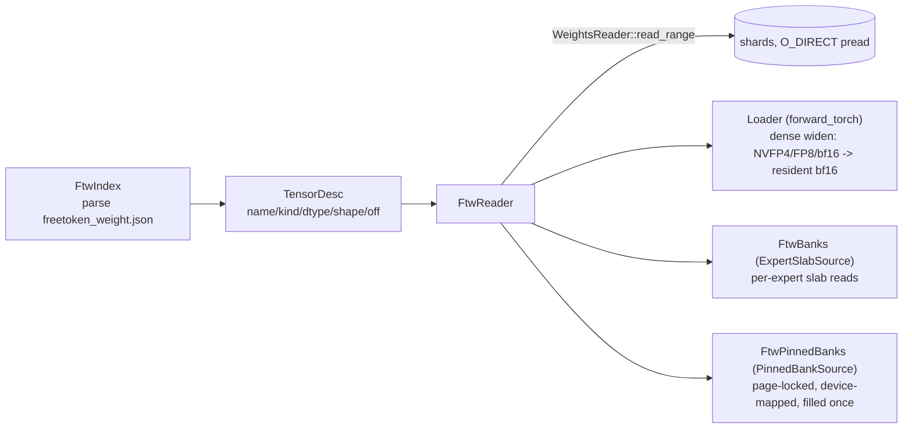

Key conventions: the FTW holds **post-loader** weights, so Gemma `1+w` norms are
already folded and must not be folded again; NVFP4 per-row globals are f16 while
FP8 scales are f32.

Reads are `pread` (`FileExt::read_at`). When the shard filesystem accepts
`O_DIRECT` the `FtwReader` reads disk straight into an aligned scratch buffer
(one `DIRECT_CHUNK` block at a time, rounded to `ALIGN`), so the dense load never
populates the page cache and stays disk-bound; on a filesystem without `O_DIRECT`
(tmpfs, some network mounts) it falls back to buffered reads. See decision 72.

**Dynamic -- dense load and resident widening.**

```mermaid
sequenceDiagram
  participant Reg as registry::build
  participant Ld as TorchQwen3_6::load
  participant Rd as FtwReader
  participant Dev as device
  participant MoE as registry::moe_port
  Reg->>Ld: load(params, device, index, reader, moe=None, cache)
  loop each dense projection / embedding / lm_head
    Ld->>Rd: read_range (4096-row window)
    Ld->>Ld: dequant to f32, cast to bf16
    Ld->>Dev: copy window into resident tensor
  end
  Note over Ld: ~4.5 GiB resident bf16;<br/>apply/gather never re-read
  Reg->>Reg: resolve_cache_slots (auto: cuMemGetInfo - reserve) / expert_bytes
  Reg->>MoE: if kernel.triton: CudaMoE(slots) + FtwPinnedBanks
  Reg->>Ld: attach_moe(port)
```

### 3.4 Model tower `[core]`

**Static.** `models/qwen3_6/` owns the arch: `config.rs` (text_config ->
`ModelParams`), `weights.rs` (tensor names), `forward.rs` (scalar oracle) and
`forward_torch.rs` (serving). Both implement `CachedModel`, so the engine cannot
tell which is loaded (decision 12/21).

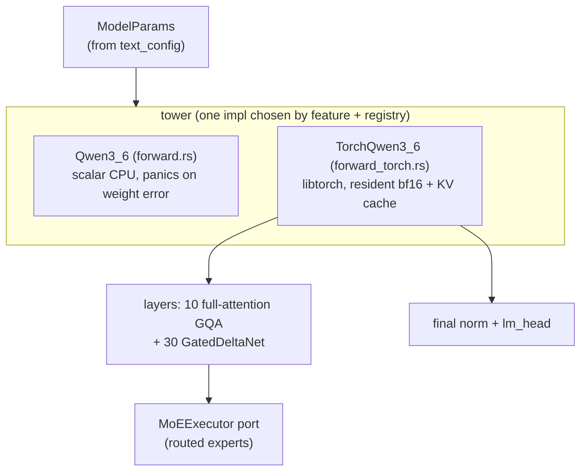

**Dynamic -- one cached decode step** (per request, single-sequence; batch is a
kernel question, not a scheduling one).

```mermaid
sequenceDiagram
  participant Eng as Engine::run_forward_cached
  participant M as TorchQwen3_6::forward_cached
  participant KV as DeviceCache / MhaPool
  participant ST as LinearStateSlabs
  participant P as MoEExecutor (CachedExperts)
  participant K as cuda_moe + cubins
  Eng->>KV: reserve(n) pages for the new tokens
  Eng->>M: forward_cached(input, cache)
  M->>M: embed -> per layer
  loop full-attention layers
    M->>KV: store K/V at tail, gather filled
    M->>M: partial rope + attention_cached (causal mask at q_offset)
  end
  loop GDN layers
    M->>ST: read conv + recurrent state at slot
    M->>M: conv1d + delta-rule recurrence
    M->>ST: write back conv + recurrent state
  end
  M->>P: execute_device(activations, ids, weights)
  P->>K: lru_ensure + index_copy + grouped GEMM
  K-->>M: routed sum (device)
  M->>M: shared expert + add; final norm
  M->>M: lm_head block pass -> out buffer (device, no host round-trip)
  M-->>Eng: forward_cached reads out back; forward_cached_into leaves it device-local
```

Both addressing modes run the same tower. `forward_cached` reads ids, positions
and the KV window from the host `SequenceCache` (`CacheAccess::Host`) and copies
the logits back; `forward_decode_into(bufs)` reads them from the device
`DecodeBuffers` (`CacheAccess::Device`) and leaves the logits device-local. The
device path gathers attention over a **fixed-length window** (`DecodeBuffers::
window`, staged per row by `stage_window`): the lagging slots are dropped by the
step-position mask and carry only a valid pool index, so the gather keeps the
same shape and addresses every step -- the precondition for a captured graph.

### 3.5 MoE offload `[core]` (whole-layer prefill overlap `[core]`)

The heart of the port. The engine's MoE obligation is split: the model computes
the router and top-k ids; `run_experts` owns
`ensure -> stream misses -> grouped GEMM -> weighted sum`.

**Static.**

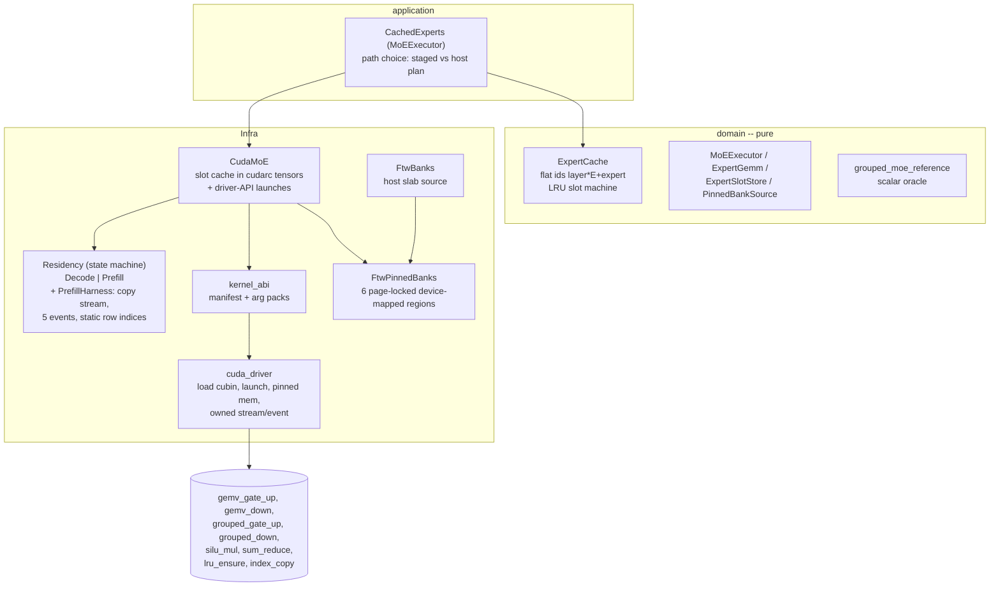

**Dynamic -- device-staged layer step** (`grouped_moe_staged`). This is the path
a captured graph needs: the residency plan never crosses to the host.

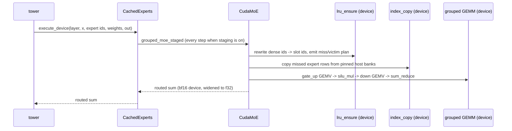

`lru_ensure` dedups first-occurrences in one CTA, so its committed `BLOCK_K = 128`
is a route cap, and its committed `BLOCK_C = 2048` caps the slot cache it can
address (decision 85). The slot count itself is `moe.cache_size_slots`: an
integer or `"auto"` (default), where auto sizes it from the free device memory
once the tower and KV pool are resident, reserving 512 MiB for the prefill
scratch and graphs (item 12, decisions 90, 127, `registry::resolve_cache_slots`). `CudaMoE::grouped_moe_staged` chunks a larger list by tokens
(`staged_chunk_tokens`) and repeats the sequence per chunk, the device LRU and
the pinned banks carrying across, so prefill uses the same device path as decode
(decision 66). `CachedExperts` without device staging still takes the host plan
(`run_experts` + `ExpertCache` + `FtwBanks`).

**Whole-layer prefill overlap `[core]`** (decision 67). When the config enables
it and the cache holds `2 * num_experts` slots (`enable_prefill_overlap`), a
prefill-shaped step (routes > `BLOCK_K`) switches the `Residency` state machine
to `Prefill`: a contiguous window of `2 * num_experts` cache slots becomes two
full-layer buffers, the router's ids pass through as slot ids offset by the
half, and there is one streamed copy of the layer plus one GEMV pass instead of
a per-chunk `lru_ensure`. Layer `l+1` is copied into the other half on a
non-blocking copy stream while layer `l` computes (`begin`/`ready`/`release`
events order the two streams). Since R10.6b (decision 120) that copy is one
`cuMemcpyBatchAsync` of six contiguous runs (one per bank) through the copy
engine, so it occupies no SMs; the batch symbol is optional, so
`FERRUM_PF_DMA=0` or a driver without it restores the `index_copy` cubin
(`BLOCK_K`-row groups over static index tensors), which `copy_missing` still
uses for decode misses. The GEMV still runs per route chunk only to bound
the `[routes, ...]` scratch. Since R10.2 (decision 112) the whole-layer path
launches the batched grouped GEMM (`launch_grouped`, one program per
(compacted buffer-slot segment, N tile) over a per-chunk slot CSR; the grid
covers only the active half's `2E` slots, R10.10/decision 128) instead of the
per-route GEMV, so
each expert's weight is read once per chunk; decode keeps the GEMV and
`FERRUM_PF_GEMV=1` forces it for the A/B. A step that drops back below the cap
returns to `Decode`; the buffer's slots are the **coldest contiguous window**
(chosen by minimum total usage on entry, freed there, with the per-half copy
rows and the `(half, expert) -> slot` map rebuilt from them), so the decode
LRU's hot set survives the prefill (decision 94) and each bank's whole layer is
one DMA run. `PrefillHarness` (the copy stream, its events and the row
indices) is retained across transitions; the driver exposes it through owned
`OwnedStream`/`OwnedEvent` handles that destroy themselves on drop. The blocks
are the cache's own slots, so this adds no expert VRAM.

### 3.6 KV cache, radix, and GDN state `[core]`

**Static.** The domain owns the bookkeeping (pages, page table, radix tree,
state-slot pool, `SequenceCache`); the adapter owns the device slabs.

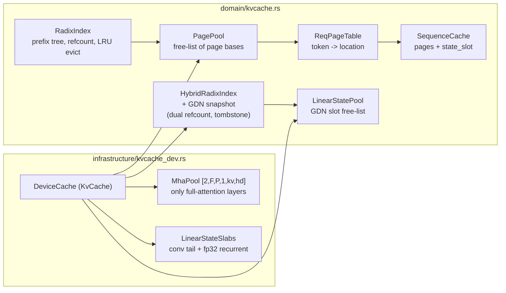

`HybridRadixIndex` shares the page pool (its `full_ref` counts KV pages) and the
state-slot pool (its `mamba_ref` counts GDN snapshots). `DeviceCache` owns the
tree and drives both commit boundaries and both eviction triggers.

**Dynamic -- prefill growth and decode step.** Pages are handed out by the
engine, the model stores K/V at those locations, and the next step reads them
back instead of re-feeding the prefix.

```mermaid
sequenceDiagram
  participant G as generation loop
  participant KV as DeviceCache (KvCache)
  participant M as torch forward
  participant P as MhaPool
  participant S as LinearStateSlabs
  G->>KV: begin() -> SequenceCache (live state slot)
  G->>KV: adopt_prefix(ids[:-1]) -> copy_slot(snapshot, live) + reuse canonical pages
  G->>KV: reserve(cache, n) -> cache.tail()
  M->>P: store(layer, tail, k, v) for full-attention layers
  M->>P: gather(layer, cache.filled())
  M->>S: state_slot read/write for GDN layers
  G->>KV: commit(ids[..end], finished=false) at each prefill chunk boundary -> snapshot + lock
  Note over G: a non-final chunk is re-queued; the final one samples
  G->>KV: commit(ids, finished=true) at finish -> donate live slot
  G->>KV: end(cache)
```

`[core]`: the plain radix tree and the hybrid tree are implemented and
unit-tested in the domain (decisions 68, 69), and `DeviceCache` drives both
commit boundaries. `adopt_prefix` matches the prompt (without its last token),
copy-on-write restores the matched GDN snapshot into the request's live slot
(`LinearStateSlabs::copy_slot`) and repoints the request at the tree's canonical
KV pages. `commit(finished=false)` snapshots the running state into a tree-owned
slot and locks the node -- at prompt end and, since decision 71, at every prefill
chunk boundary, so a prefix that ends mid-prompt is reusable too;
`commit(finished=true)` at finish donates the request's final live slot zero-copy
and clears the request. Repeated non-finished commits advance the reused span
without freeing a page (the tree adopts the pages the request already holds).
Pressure drives eviction: `reserve` reclaims pages via `evict_full`; snapshot
allocation reclaims slots via `evict_mamba`. The two pools are independent, so no
partitioning is needed. The state pool is sized `2 * max_running_requests + 1`
(+1 for the capture padding row): one live slot and one locked chunk snapshot per
running request, plus progress headroom, because a snapshot is COWed while the
request still holds its previous node's lock (item 10, decision 91). For this
30-GDN/10-attention tower a match is only
reusable up to the deepest node with a live GDN state snapshot, which is why the
snapshot donation (not the KV tree alone) is the point (decision 65). KV is f32
or bf16: `[kv] dtype` picks it and the default is bf16 (half the bytes; the lever
when VRAM binds), while `fp8` -- the checkpoint's declared `kv_cache_quant_algo`
-- is still `[TODO]`. Gathers always return f32, so the attention math is
dtype-agnostic and the f32-only paged decode kernel is skipped for a bf16 pool.

### 3.7 Scheduler and sampling `[core]`

**Static.** Pure logic in `domain/scheduler.rs` and `domain/sampling.rs`.

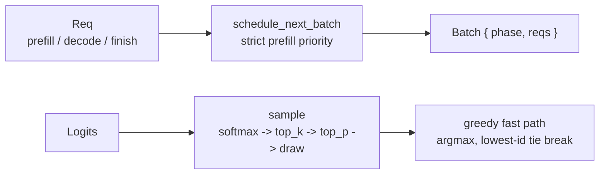

**Dynamic.** Strict prefill-priority: a step is either prefill or decode, never
both. Pending requests are admitted in `uid` order and split across
`max_prefill_tokens`; a prompt longer than the budget is fed in chunks across
steps, and a continuation chunk (`is_chunk()`) is re-queued rather than sampled.
Decode rows are sorted by `uid` for determinism. Stop priority is
EOS/stop-string over max-tokens.

### 3.8 HTTP serving and generation `[core]`

**Static.** `infrastructure/http.rs` (axum) exposes `/v1/completions`,
`/v1/chat/completions`, `/v1/responses`, `/v1/models`, `/health`;
`application/generation.rs` owns the loop; `application/dispatcher.rs` owns the
single model worker; `tokenizers_hf.rs` encodes/decodes and renders the chat
template. The chat endpoint carries OpenAI tool calling (decision 74):
`ChatMessage`/`ChatTool` (domain `tokenizer.rs`) are rendered with `tools`, and
`tool_call.rs` parses the checkpoint's `<tool_call>` dialect out of the answer.
Non-stream turns the whole answer into a `tool_calls` message; the chat stream
buffers once a `<tool_call>` opener appears and emits `tool_calls` deltas,
finishing with `finish_reason: "tool_calls"`.

`/v1/responses` (decision 109) is the stateless Responses subset for Codex. Its
`input` (string or items), `instructions` and flattened `tools` are mapped onto
the same `ChatMessage`/`ChatTool` and rendered by the same `render_chat`, so
tool calling is identical; `function_call`/`function_call_output` items become
the assistant/tool turns the chat template already understands. The answer is
re-parsed with `parse_tool_calls` and emitted as Responses output items
(`message` with `output_text`, `function_call`) or, on `stream: true`, as
`response.created` / `output_text.delta` / `function_call_arguments.delta` /
`response.completed` events over the same per-token `ChatStream` and bounded
sink. `store`, `previous_response_id`, `text`, `reasoning` and `metadata` are
accepted and ignored: the server keeps no response state and reasoning is out of
scope.

**Dynamic -- a streaming request.** Handlers never call the model directly: they
tokenize, submit a `Job` to the `Dispatcher`, and await its reply. The dispatcher
worker coalesces the queued jobs into one `run_batch` (one captured decode step
for every live row), which is both the batching lever (item 11) and what keeps
the single CUDA stream / MoE slot cache / prefix tree free of concurrent
access.

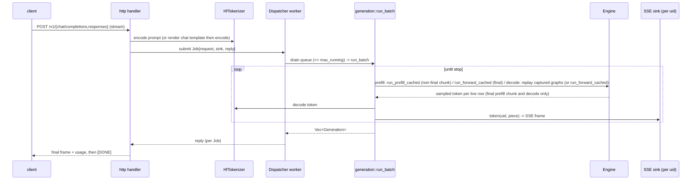

The dispatcher worker is a dedicated OS thread (the forward is blocking
GPU/CPU work, never on the tokio runtime). A stream's frames ride a bounded
channel and a per-request sink returns `false` when it is full, which aborts
only that request instead of stalling the batch. `Request` carries its own seed,
so co-batching never changes a lone request's tokens.

### 3.9 CUDA-graph decode capture `[core]`

One captured executable per decode batch size, over the whole forward, with the
MoE launches inside it (decision 40). The composition root builds the side
stream, the buffers and the graphs at load and hands the engine the
`CapturedDecode` service; the generation loop replays the smallest captured size
that fits a decode step (decision 61).

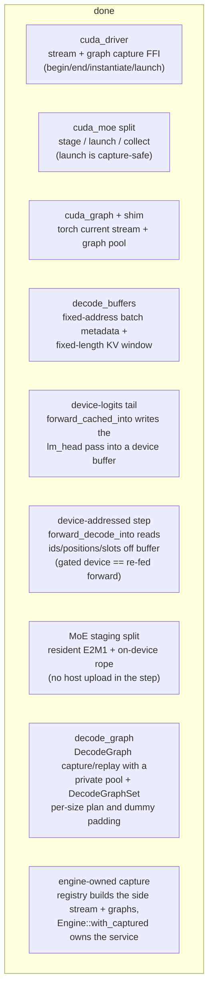

**Dynamic -- capture at load (composition root) and replay (engine).**

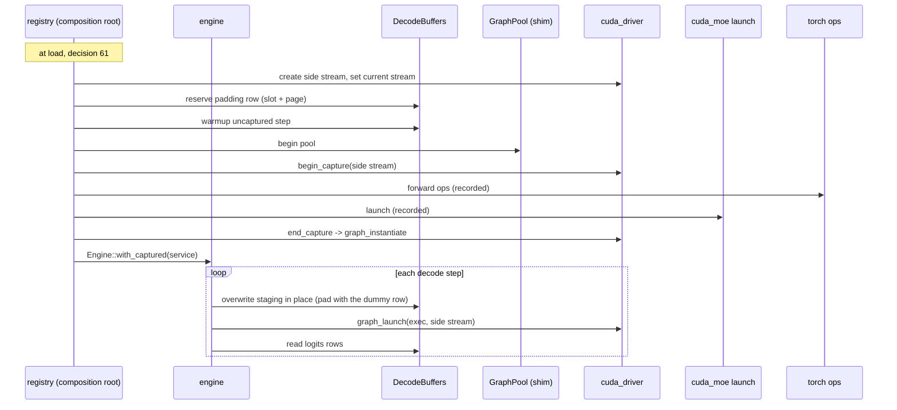

Contracts already fixed: capture runs only on a flags-0 side stream (never the
legacy stream); a `StagedGroup` and the pinned banks must outlive every graph
captured over them; a captured grid pins the batch shape; `stage_into` is the
only writer between replays. The whole step is now capture-shaped *and*
batch-generic: `forward_decode_into` runs every row of `DecodeBuffers`, with the
`CacheAccess::Device` arms of `full_attention_cached` / `gdn_cached` reading
batched pool and state accessors (`MhaPool::gather_rows`,
`LinearStateSlabs::{conv,recurrent}_state_rows`) and additive batched peers
(`conv1d_silu_step_batch`, `gdn_recurrence_step_batch`, `gdn_core_batch`) beside
the untouched single-row host helpers; only the tower tail branches (prefill
normalizes the last token, decode normalizes all rows). The device attention arm
runs the paged GQA kernel through `infrastructure/cuda_attention.rs`
(`PagedAttention`): it loads the `attention` manifest section and launches the
AOT cubin on the capture's stream, reading the row's KV straight out of the
`MhaPool` slabs (`kv_slab_ptrs`) through the staged `DecodeBuffers` location
window; when the launcher is absent or the pool is not f32 the arm falls back to
the dense padded-window gather (decision 55). The device GDN arm runs the fused
decode kernel through `infrastructure/cuda_gdn.rs` (`GdnDecode`): it loads the
`linear` manifest section and launches the AOT cubin on the capture's
stream, folding the gating, the q/k L2-norm and the delta-rule update into one
launch per layer and reading/writing the row's `LinearStateSlabs` recurrent state
in place; when the launcher is absent (CPU, decision 21) the arm keeps the
op-by-op `gdn_core_batch` (decision 77). The same launcher's `tri_solve` runs the
prefill chunked recurrence's triangular solve (`gdn_tri_solve`, decision 103),
with the libtorch row loop as the fallback. The forward's tail is
device-local: `TorchQwen3_6::forward_cached_into` writes the `lm_head` block pass
straight into a caller-owned `[rows, vocab]` device logits buffer with no host
round-trip, and `forward_decode_into` addresses the same forward entirely from a
`DecodeBuffers` row (ids, positions, state slots, fixed KV window). The
device-staged MoE port (`routed_via_port` -> `grouped_moe_staged`) reads its
activations, router ids and route weights off device buffers, keeps its `E2M1`
decode table resident, and builds the rope table on the device, so no step
uploads a host tensor. `infrastructure/decode_graph.rs` then captures one
`DecodeGraph` per batch size -- each with its own private torch graph pool and
its fixed-address `DecodeBuffers` -- and a `DecodeGraphSet` picks the smallest
captured size that fits a step and pads the tail with dummy rows (decision 59).
`tests/decode_graph_capture.rs` captures one whole real decode step and replays
it equal to the uncaptured twin, and its batch gate replays `{1,2,4}` equal to
the uncaptured twin. The composition root (`application/registry.rs`) now owns
the allocation: with `model.cuda_graph` on, it creates the side stream, builds
the MoE and attention ports on it, reserves the dummy padding row (which needs
one extra state slot, hence the `state_slots(N, padding)` pool), records the
graphs for `graph_batch_sizes(max_running)` and returns them in
`BuiltModel::captured`, which `load_engine` passes to `Engine::with_captured`
(decision 61). A captured build keeps torch on the side stream: `run_step` binds
it before staging and `TorchQwen3_6::bind_stream` binds it for every forward, so
prefill's torch ops do not race the driver-API MoE and attention launches. The
gated `tests/engine_real_generate.rs::a_captured_engine_decodes_on_its_graphs`
reaches the oracle token through the captured graph.

---

## 4. External libraries and where they are used

| Library / tool | Kind | Used by | Purpose |
|---|---|---|---|
| `libtorch` (via `tch`) | runtime, `cuda` feature | `infrastructure/torch.rs`, `models/qwen3_6/forward_torch.rs`, `infrastructure/kvcache_dev.rs`, `infrastructure/cuda_moe.rs`, `infrastructure/decode_graph.rs` | All dense compute (GEMMs, norms, rope, attention, GDN), device tensors, the KV/state slabs, and the MoE slot banks |
| `cudarc` 0.19.10 | runtime, non-default `cudarc` feature | `infrastructure/cudarc.rs`, `models/qwen3_6/{load_cudarc,forward_cudarc}.rs`, `tests/cudarc_{adapter,load,forward}.rs` | M7 torch-less tensor adapter: owned bf16/f32/i32/i64/u8 buffers, cuBLAS BF16/f32 GEMM, committed cubins, capture, and the elementwise/unary/scalar/col-scale/reduction/softmax/top-k/rope/head-repeat kernels; M7.2 loads the dense text tower with the serving storage policy, M7.3 ports the dense math, rope and GDN primitives. Not on the serving path |
| CUDA driver API (`libcuda.so.1`) | runtime, hand-rolled FFI | `infrastructure/cuda_driver.rs` | Load and launch the cubins, allocate device + page-locked memory, capture and replay CUDA graphs |
| Triton (cubins) | build-time authoring; artifacts embedded at compile time | `python/ferrum_kernel/*`, `nix/kernels.nix` | The hand-written NVFP4 grouped-MoE GEMV, the silu/sum-reduce, the two offload staging kernels, and the paged GQA decode attention kernel. Authored and AOT-compiled in Python; launched by `cuda_driver` with no interpreter at runtime |
| `c10_cuda` (torch C++) | runtime, via `build.rs` shim | `shim/c10_graph_shim.cpp`, `infrastructure/cuda_graph.rs`, `infrastructure/decode_graph.rs` | The torch current-stream set and the graph memory pool that `tch` does not expose; needed for CUDA-graph capture of torch ops |
| `axum` + `tokio` | runtime | `infrastructure/http.rs`, `main.rs` | HTTP server, SSE streaming, and the async runtime that offloads forwards to blocking threads |
| `tokenizers` + `minijinja` | runtime | `infrastructure/tokenizers_hf.rs` | HF byte-level BPE tokenizer and the checkpoint's chat template (Python string methods rewritten to filters; `json` feature for the template's `tojson`) |
| Python + `uv` (FreeToken venv) | build-time only | `scripts/convert_hf_to_ftw.py`, `FreeToken/` | The one-time HF -> FTW conversion via `ft checkpoint`; never in the serving process |

Boundary note: `tch`/`Tensor` and the CUDA driver handles live entirely in
`infrastructure`; the domain sees only `MoETensor`, counts and opaque bytes.

**Planned boundary `[partial]`: torch-less tensor runtime (M7).** Replace
`tch` with a Rust tensor runtime behind the same `cuda` adapter boundary.
M7.0 chose a minimal `cudarc` layer over candle (decision 124); M7.1 built it
behind the non-default `cudarc` feature (decision 126). It owns device tensors
(bf16/f32/i32/i64/u8), cuBLAS BF16 GEMM, the committed cubins, raw pointers and
the stream the driver launches on; its capture/parity gates are green, and
M7.2's `models/qwen3_6/load_cudarc.rs` loads the dense tower through it with
the serving storage policy (decision 129), and M7.3's
`models/qwen3_6/forward_cudarc.rs` ports the dense math primitives, rope and
the GDN gates/L2 norm/GQA expand (decisions 130, 131). It is not on the serving
path:
`forward_torch.rs` still uses `tch` until M7.3, and `shim/c10_graph_shim.cpp`
disappears with libtorch in M7.5.

---

## 5. Cross-cutting invariants

- **One allocator, one CUDA context.** The slot banks are libtorch tensors and
  the driver launches read their raw pointers, so there is a single context and
  a single allocator behind both paths.
- **Stable addresses for capture.** Dense weights, MoE banks and pinned host
  banks are allocated once and never move; that is a precondition for a captured
  graph to bake their pointers.
- **A captured build follows one stream.** When the composition root captures, the
  driver-API MoE and attention launches and every torch op of a forward run on the
  capture's flags-0 side stream: `EngineDecodeGraphs::run_step` binds it before
  staging and `TorchQwen3_6::bind_stream` binds it for each forward, so the
  staged H2D copies, the recorded ops and the replay are ordered on one stream.
- **Least-lock, `&self` ports.** The device slot cache is process-wide, so the
  store/gemm ports take `&self` and `Mutex<CudaMoE>` is passed as both.
- **Host/device boundary.** The serving forward is device-resident except
  tokenization, scheduling and sampling, which run on the host; only token ids,
  streamed expert rows (H2D) and logits (D2H) cross the boundary (section 1.1).
- **The scalar forward is an oracle.** It stays behind the same `Model` trait,
  is what runs in the CPU build, and is what the libtorch path is checked
  against (plus the pinned FreeToken token oracle).
- **Gated tests.** GPU-only work is `--ignored` and run under
  `scripts/run-gated.sh` (serial, address-space capped); CPU-only units run in
  plain `cargo test`.
